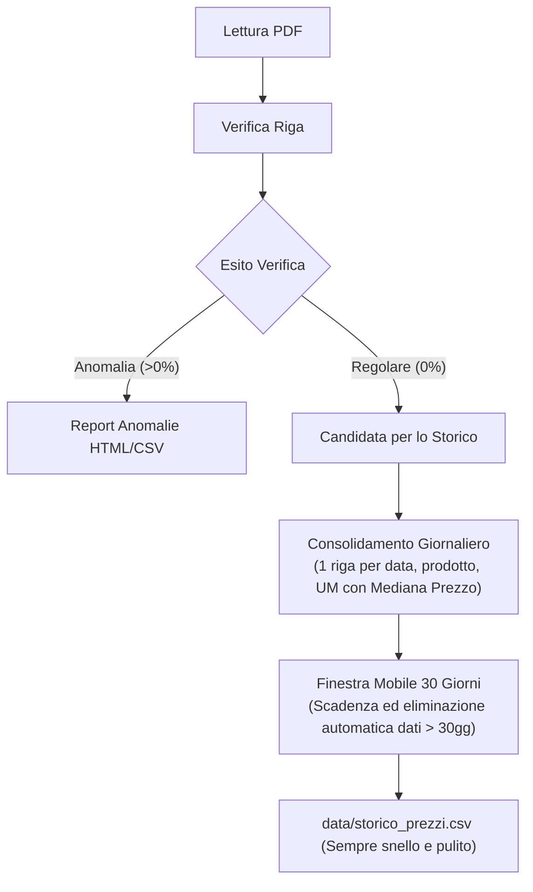

# Progetto: Controllo Fatture Ortofrutta

Sistema di verifica automatica, rilevamento anomalie e monitoraggio dinamico dei prezzi per fatture ortofrutticole (formato PDF).

---

## Indice dei Contenuti
1. [Obiettivo del Progetto](#1-obiettivo-del-progetto)
2. [Struttura delle Cartelle](#2-struttura-delle-cartelle)
3. [Guida all'Uso Quotidiano](#3-guida-alluso-quotidiano)
4. [Logica dei Controlli e Livelli di Attendibilità](#4-logica-dei-controlli-e-livelli-di-attendibilità)
5. [Architettura Dati e Storico Snello (Finestra 30 Giorni)](#5-architettura-dati-e-storico-snello-finestra-30-giorni)
6. [Mappa Tecnica del Codice (`src/controlla_fatture.py`)](#6-mappa-tecnica-del-codice)
7. [Guida alla Manutenzione Futura](#7-guida-alla-manutenzione-futura)

---

## 1. Obiettivo del Progetto

Nel settore ortofrutticolo i prezzi cambiano rapidamente e le fatture contengono molteplici variabili (colli, casse, peso lordo/tara/netto, pezzi per collo, diverse unità di misura).  
Gli errori tipici di fatturazione o caricamento dati includono:
1. **Errore Matematico di Calcolo**: discordanza tra `Quantità * Prezzo Unitario` e `Totale Riga`.
2. **Virgola Decimale Spostata**: fattore 10x o 100x dovuto a battitura (es. Lattuga a `14.00 €/kg` anziché `1.40 €/kg`).
3. **Confusione Colli / Pezzi**: fatturare al pezzo anziché a cassa o moltiplicare erroneamente `Colli * Pz * Prezzo`.
4. **Prezzi Fuori Range di Mercato**: scostamenti ingiustificati rispetto ai prezzi praticati nel periodo corrente.

---

## 2. Struttura delle Cartelle

```text
Controllo-fatture/
│
├── Fatture-da-controllare/     # Cartella dove inserire i file PDF da analizzare
├── Fatture-archiviate/         # Spostamento opzionale dei PDF già verificati
├── data/
│   ├── range_prezzi.json       # Database statico di base e regole per prodotto
│   ├── storico_prezzi.csv      # Storico dinamico snello (ultimi 30 giorni consolidati)
│   └── ultima_analisi.json     # Ultimi risultati UI, ripristinati al riavvio
├── report/
│   └── report_ultimo.html      # Report HTML aggiornato a ogni analisi (un solo file)
├── AVVIA_CONTROLLO.bat         # Script rapido per avviare il controllo con doppio clic
├── ISTRUZIONI.md               # Questo manuale operativo e tecnico
└── src/
    ├── controlla_fatture.py    # Motore principale (estrazione, analisi, storico)
    └── ui_textual.py           # Interfaccia testuale e report interni
```

---

## 3. Guida all'Uso Quotidiano

### Passo 1: Inserimento Fatture
Copia i file PDF delle fatture ricevute nella cartella:
`Fatture-da-controllare/`

### Passo 2: Avvio del Controllo
Fai doppio clic su:
`AVVIA_CONTROLLO.bat`  
*(oppure da terminale PowerShell: `python src/controlla_fatture.py`)*

Se vuoi usare la semplice interfaccia testuale (Textual), apri invece:
`AVVIA_UI.bat`  
oppure esegui:
```powershell
python src\ui_textual.py
```

Nella UI puoi mantenere la cartella predefinita `Fatture-da-controllare` o modificarla. Dopo l’analisi, **Visualizza report** apre una schermata con le anomalie dell’ultimo controllo; puoi passare da sole anomalie a tutte le righe e tornare al menu principale. **Apri report HTML** apre il report completo dell’ultima analisi; il file `report/report_ultimo.html` viene sovrascritto a ogni controllo, senza creare copie storiche o CSV. L’ultima analisi viene anche salvata in `data/ultima_analisi.json` e ripristinata al successivo avvio, mentre lo storico prezzi continua ad aggiornarsi in `data/storico_prezzi.csv`.

Se desideri analizzare solo un file PDF specifico:
```powershell
python src/controlla_fatture.py nome_file.pdf
```

### Passo 3: Consultazione dei Risultati
Nell’interfaccia Textual, premi **Visualizza report** per consultare le anomalie e, se necessario, tutte le righe dell’ultima analisi. Premi **Apri report HTML** per aprire nel browser il report completo; il file viene sempre sovrascritto alla successiva analisi. Eventuali vecchi file HTML/CSV nella cartella `report/` sono residui e non vengono aggiornati né usati.

### Passo 4: Archiviazione dei PDF
Lo storico prezzi conserva la memoria delle transazioni. È possibile spostare periodicamente i file PDF controllati in `Fatture-archiviate/` per mantenere pulita la cartella di lavoro: il programma non perderà la conoscenza dei prezzi registrati.

---

## 4. Logica dei Controlli e Livelli di Attendibilità

Ogni riga analizzata viene sottoposta a 4 livelli gerarchici di verifica, con assegnazione di un punteggio di attendibilità dell'errore (da 0% a 100%):

| Attendibilità | Gravità | Descrizione | Logica di Rilevamento |
| :---: | :---: | :--- | :--- |
| **100%** | **CRITICO** | **Errore Matematico Certo** | Differenza assoluta tra `Quantità * Prezzo` e `Importo Fatturato` > 0.05 €. |
| **100% / 85%** | **CRITICO** | **Errore Colli × Pezzi** | Importo fatturato coincidente con `Colli * Pezzi * Prezzo` anziché `Colli * Prezzo` (o moltiplicazione per i soli pezzi). |
| **95%** | **CRITICO** | **Virgola Decimale Spostata** | Rapporto tra importo fatturato e importo atteso pari a un fattore 10x, 100x o 0.1x. |
| **90%** | **CRITICO** | **Prezzo Fuori Scala 4x / 5x** | Prezzo unitario superiore a 4 volte la mediana del periodo (chiaro errore di scala o scambio unità di misura). |
| **70% - 75%** | **SOSPETTO** | **Prezzo Fuori Range Stagionale** | Prezzo che sfora oltre il +50% dal massimo o sotto il -50% dal minimo della finestra mobile a 30 giorni. |
| **40% - 50%** | **ATTENZIONE** | **Scostamento Moderato** | Prezzo superiore al range del periodo tra il +25% e il +50%. |
| **0%** | **REGOLARE** | **Riga Conforme** | Calcoli corretti e prezzo allineato ai valori di mercato. |

---

## 5. Architettura Dati e Storico Snello (Finestra 30 Giorni)

Nell'ortofrutta i prezzi variano sensibilmente con le stagioni. Accumulare migliaia di vecchie righe sarebbe dannoso e porterebbe a confrontare prodotti estivi con listini invernali.  
Per questo motivo il sistema implementa un'architettura **"Smart & Lean"**:



### Regole dello Storico ([`data/storico_prezzi.csv`](file:///C:/Users/mammo/Documents/Sviluppatore/Controllo-fatture/data/storico_prezzi.csv))
1. **Filtro di Qualità Assoluto**: Entrano nello storico **soltanto le righe a 0% anomalie**. Gli errori di battitura non inquinano mai il database.
2. **Consolidamento Giornaliero (1 Rilevazione al Giorno)**: Se nella stessa giornata (es. 16/10/2026) sono presenti più fatture con lo stesso articolo, il programma calcola la **mediana dei prezzi del giorno** e somma volumi e colli. Non esistono record duplicati.
3. **Decadimento Naturale a 30 Giorni (Rolling Window)**: Qualsiasi rilevazione più vecchia di 30 giorni rispetto alla data più recente viene scartata ed eliminata automaticamente. Il file mantiene un massimo di 20-22 rilevazioni per prodotto (i giorni lavorativi del mese).
4. **Idempotenza**: Rilanciare il controllo sullo stesso file PDF non crea duplicati.

### Come Lavora il Confronto Prezzi ([`IndicePrezziTemporale`](file:///C:/Users/mammo/Documents/Sviluppatore/Controllo-fatture/src/controlla_fatture.py))
Quando viene controllata una fattura:
- **Livello 1 (Finestra Temporale Mobile)**: Cerca tutte le osservazioni comprese tra `Data Fattura - 30 giorni` e `Data Fattura + 7 giorni`. Se ci sono almeno 3 rilevazioni, fissa il range tra `Mediana * 0.65` (-35%) e `Mediana * 1.45` (+45%).
- **Livello 2 (Cross-Check Giornaliero)**: Se il controllo viene eseguito a fine giornata con tutte fatture odierne, il programma compara anche i prezzi dei diversi fornitori della stessa giornata per isolare chi è fuori mercato.
- **Livello 3 (Fallback Listino Base)**: Se un articolo compare per la prima volta o ha meno di 3 rilevazioni recenti, fa riferimento a [`data/range_prezzi.json`](file:///C:/Users/mammo/Documents/Sviluppatore/Controllo-fatture/data/range_prezzi.json).

---

## 6. Mappa Tecnica del Codice

Il file principale è [`src/controlla_fatture.py`](file:///C:/Users/mammo/Documents/Sviluppatore/Controllo-fatture/src/controlla_fatture.py). Ecco la suddivisione delle responsabilità:

| Sezione / Funzione | Scopo e Responsabilità | Dove Intervenire |
| :--- | :--- | :--- |
| `FINESTRA_GIORNI_DEFAULT = 30` | Costante di configurazione dell'arco temporale dello storico. | Riga 31 |
| `to_float()` | Converte stringhe con virgola italiana o punto decimale in float sicuro. | Righe 33-43 |
| `parse_date()` | Interpreta formati data (`GG/MM/AA`, `GG/MM/AAAA`, `AAAA-MM-GG`). | Righe 45-56 |
| `normalizza_nome()` | Rimuove codici numerici prefissi e suffissi di nazionalità (`IT`, `ES`, `FR`). | Righe 58-67 |
| `estrai_righe_da_pdf()` | Parser visivo PDF con PyMuPDF (`fitz`). Estrae numero fattura, data, cliente, colli, tara, netto, UM, prezzi. | Righe 101-224 |
| `IndicePrezziTemporale` | Classe in-memory con cache per il calcolo istantaneo delle mediane mobili a 30 giorni. | Righe 226-322 |
| `analizza_riga()` | Motore di regole: controlla matematica, virgole 10x, colli*pz e tolleranze prezzo. | Righe 324-434 |
| `genera_report_html()` | Funzione legacy, non più richiamata dal flusso di controllo. | Righe 436-635 |
| `genera_report_csv()` | Funzione legacy, non più richiamata dal flusso di controllo. | Righe 637-664 |
| `carica_storico_prezzi()` | Legge i dati storici validati da `data/storico_prezzi.csv`. | Righe 665-693 |
| `aggiorna_storico_prezzi()` | Applica il consolidamento giornaliero, elimina i dati > 30gg e sovrascrive il CSV compatto. | Righe 695-788 |
| `main()` | Orchestratore: gestisce argomenti CLI, ciclo PDF, barra di avanzamento e salvataggio. | Righe 790-880 |

---

## 7. Guida alla Manutenzione Futura

### A. Modificare l'ampiezza della Finestra Temporale
Se in futuro desideri estendere lo storico a 45 o 60 giorni (ad esempio in primavera/autunno per seguire transizioni più lunghe):
1. Apri `src/controlla_fatture.py`.
2. Modifica la riga 31:
   ```python
   FINESTRA_GIORNI_DEFAULT = 45  # oppure 60
   ```

### B. Resettare o Ripulire lo Storico Prezzi
Se desideri ripartire da zero con lo storico (ad esempio all'inizio di un nuovo anno):
1. Apri il file `data/storico_prezzi.csv`.
2. Cancella tutte le righe lasciando solo la prima riga di intestazione:
   ```csv
   data_fattura,fornitore,prodotto,colli,quantita,um,prezzo_unitario,totale_riga,stato_validazione,note
   ```
3. Al prossimo avvio il file verrà ripopolato automaticamente con i nuovi dati freschi.

### C. Aggiungere un Prezzo Fisso o Regola Manuale
Se hai un prodotto speciale che deve avere range rigidi:
1. Apri `data/range_prezzi.json`.
2. Modifica o inserisci la chiave normalizzata del prodotto:
   ```json
   "zenzero fresco": {
     "um_principale": "KG",
     "per_um": {
       "KG": {
         "prezzo_min": 3.00,
         "prezzo_max": 6.50,
         "prezzo_medio_rilevato": 4.50,
         "osservazioni": 1
       }
     }
   }
   ```

### D. Adattare il Parser PDF per Nuovi Fornitori
Se un nuovo fornitore emette un PDF con una formattazione diversa:
- La funzione `estrai_righe_da_pdf()` in `src/controlla_fatture.py` individua le colonne tramite l'intestazione tabellare (`Art.`, `Descrizione`, `Prezzo`).
- Se i nomi delle colonne cambiano o sono disposti diversamente, basta aggiornare le espressioni regolari alle righe 134-160 di `src/controlla_fatture.py`.
